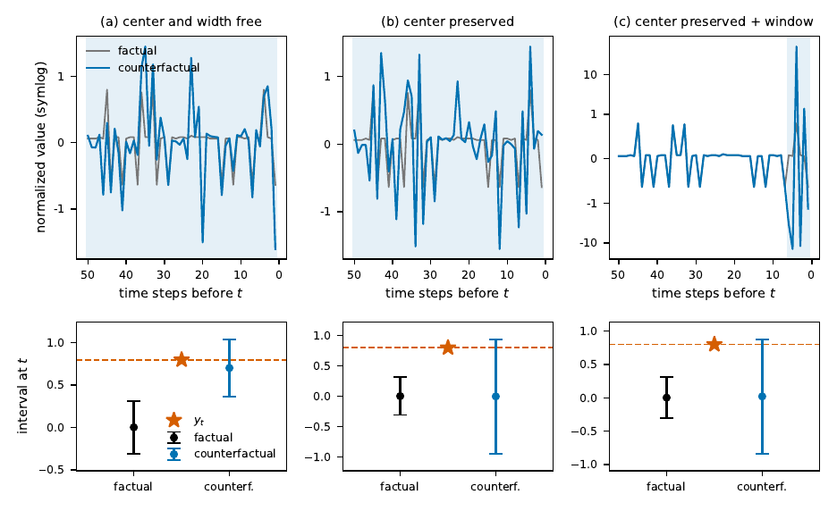
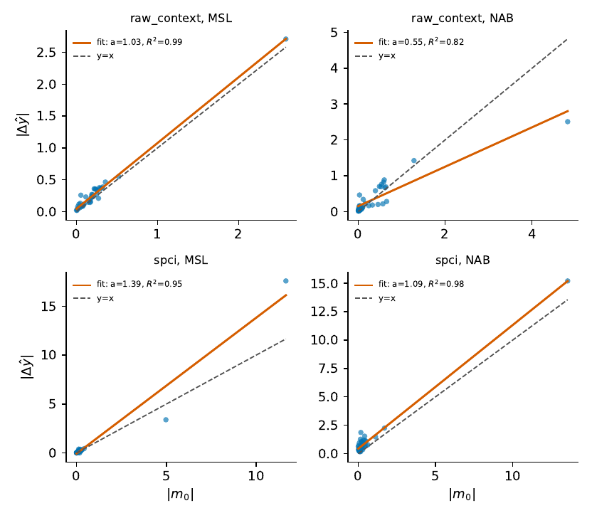
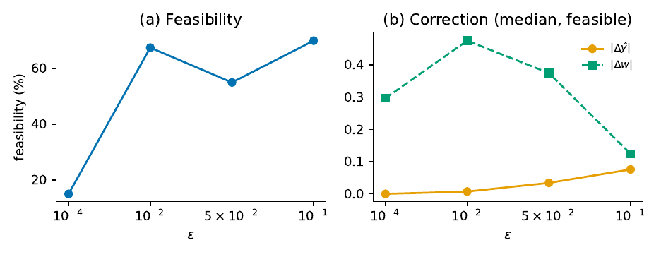
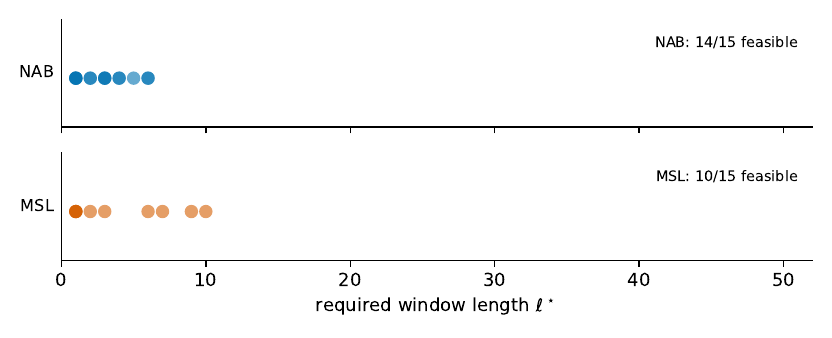
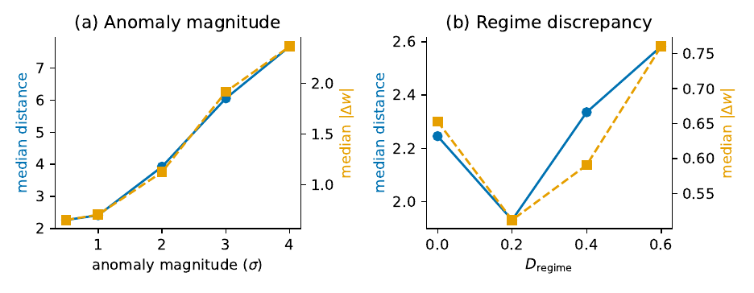

# cfx_framework

Counterfactual explanations for conformal prediction intervals in time-series
anomaly detection. A counterfactual here is an alternative history that changes
the position of a fixed observation relative to its prediction interval. The
code builds the conformal backbones, trains a latent decoder, and searches for
counterfactuals under validity, plausibility, proximity and sparsity
constraints. The paper associated with this code is under review.

## Installation

    pip install -r requirements.txt

Python 3.10+ and PyTorch are required. A GPU is optional.
`granite-tsfm` and `huggingface_hub` are only needed for the TSFM backbone
(Exp. 15), which downloads a pretrained Granite TTM model.

## Data

The datasets are not included. Download them and set the environment variables
below (the loaders also look in `./NAB`, `./telemanom`, `./UCR_Anomaly_FullData`).

| Dataset | Source | Variable |
|---|---|---|
| MSL | telemanom benchmark (Hundman et al., 2018), https://github.com/khundman/telemanom | `MSL_PATH` |
| NAB | Numenta Anomaly Benchmark, https://github.com/numenta/NAB | `NAB_PATH` |
| UCR Anomaly Archive | Wu and Keogh, 2021 (also in https://github.com/TheDatumOrg/TSB-UAD) | `UCR_PATH`, `UCR_SERIES_NAME` |

The synthetic experiments (Exp. 13, 14) generate their own data.

## Running the experiments

    python protocol.py --list          # list the experiments
    python protocol.py --exp exp6      # run one experiment
    python protocol.py --exp exp5      # UCR (needs UCR_SERIES_NAME, e.g. InternalBleeding5)

Each run writes `results_<exp>.csv` in the current directory. Pretrained
decoders are cached in `cache_decoders/` (`python setup_cache.py` rebuilds
them). `python smoke_test.py` runs a quick sanity check.

## Result files

The CSV files included here are the ones produced by the experiments.

| File | Experiment | Content |
|---|---|---|
| `results_exp1.csv` | Exp. 1 | Split CP control |
| `results_exp2.csv`, `results_exp3.csv` | Exp. 2, 3 | Channel decomposition (MSL, NAB) |
| `results_exp4.csv` | Exp. 4 | Generalization across backbones and datasets |
| `results_exp5.csv` | Exp. 5 | UCR control |
| `results_exp6.csv`, `results_exp6_1.csv` | Exp. 6 | Center shift identity |
| `results_exp7.csv` | Exp. 7 | Sensitivity to epsilon |
| `results_exp8.csv` | Exp. 8 | Search methods (Adam, multistart, slow schedule, genetic, hybrid) |
| `results_exp9.csv` | Exp. 9 | Cascade |
| `results_exp10.csv`, `results_exp11.csv` | Exp. 10, 11 | Temporal window (MSL, NAB) |
| `results_exp13.csv`, `results_exp14.csv` | Exp. 13, 14 | Synthetic AR and regime change |
| `results_exp15.csv` | Exp. 15 | TSFM backbone |

## Example and figures

A counterfactual for one anomalous observation on NAB (case 622). The top row
shows the factual history and its counterfactual, the bottom row shows the
conformal interval at time t before and after. In (a) both the center and the
width of the interval can change, in (b) the center is preserved so that only
the width changes, and in (c) the change is additionally restricted to a short
window of recent time steps.

Center shift against the margin, for two conformal backbones (raw context and
SPCI) on MSL and NAB:

Sensitivity to the center-preserving tolerance epsilon:

Temporal window scan (sparsity):

Synthetic experiments (autoregressive and regime change):

The scripts that produce these figures are in `figures/`, see
`figures/README.md`. The PDF versions are in the same folder.

## Code layout

`config.py` (settings), `data.py` (loaders), `backbones.py` and
`tsfm_backbone.py` (conformal backbones), `decoders.py` (latent decoder),
`margin.py` (margin), `search.py` and `search_variants.py` (latent search and
its variants), `criteria.py` (metrics), `protocol.py` (experiments),
`plotting.py` (plot helpers). Some comments are written in French.

## License

MIT, see `LICENSE`.
